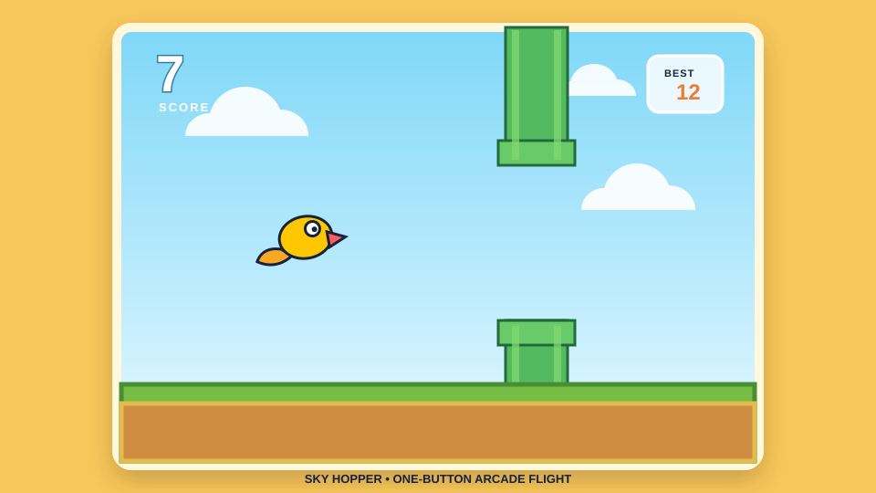

# Sky Hopper

A bright, single-page arcade game inspired by the one-button flying genre. Guide the yellow hopper through the pipe gaps using **Space**, **Up Arrow**, or a tap/click. Your best score is saved in the browser.

## Preview



Open `voice-cloner.html` directly in a browser to play.

## Tests

Install dependencies and run the unit tests:

```sh
npm install
npm test
npm run test:coverage
```
